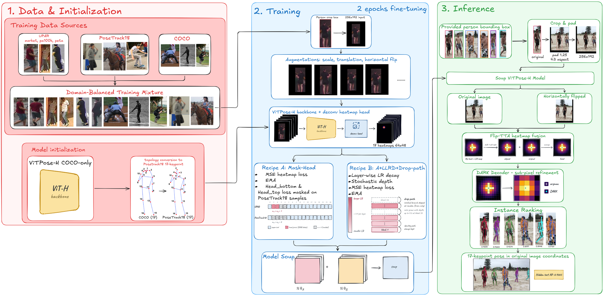
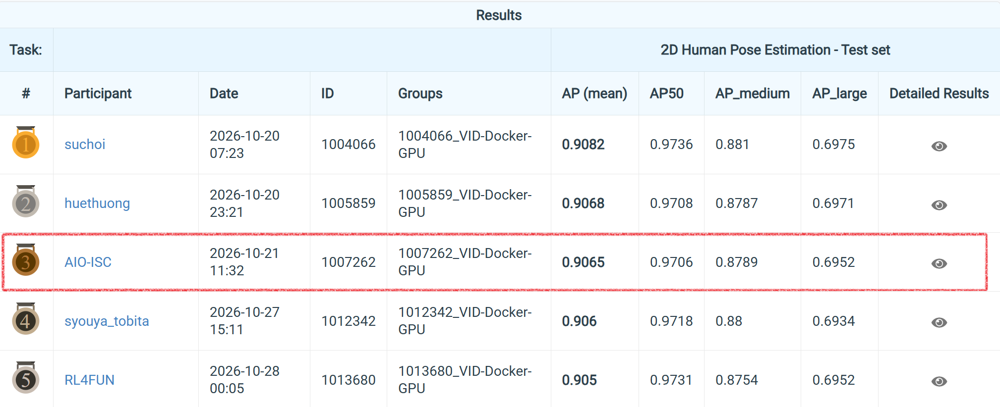
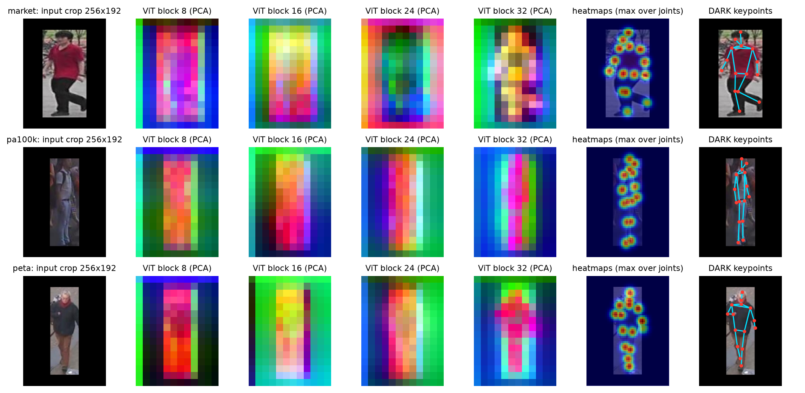

<div align="center">

# UPAR Challenge 2027 — Track 3: Surveillance 2D Human Pose Estimation

**🥉 3rd place solution of Team AIO-ISC**

[RWS Workshop @ WACV 2027](https://vap.aau.dk/rws/challenge/) · Paper (coming soon) · [Weights](https://github.com/Ripefog/upar2027-track3-code/releases/tag/final-weights)


-orange)


</div>

<p align="center"></p>

## News

- **2026-11** — Our paper on this solution is accepted at the RWS Workshop @ WACV 2027.
- **2026-10** — 3rd place on the final Track 3 leaderboard with 0.9065 AP.

## Leaderboard

<p align="center"></p>
<p align="center"><em>Final Codabench leaderboard (top 5). AP is the mean OKS AP 0.50:0.95 over the four hidden subsets.</em></p>

## Task

UPAR Challenge 2027 Track 3 evaluates **top-down 2D pose estimation of pedestrians in surveillance images**. For each provided person box, a method predicts 17 keypoints in PoseTrack18 order and one pose score; no person detector is involved.

| | |
|---|---|
| **Keypoints** | 17 PoseTrack18 slots. Slots 1–2 are `head_bottom` and `head_top` (not in COCO); slots 3–4 (ears) are not scored → 15 scored joints |
| **Training data** | Market-1501, PA-100K, PETA (UPAR); COCO and PoseTrack18 also allowed |
| **Hidden test** | 30,245 person boxes from four unreleased surveillance subsets; only the aggregate score is reported |
| **Metric** | OKS AP 0.50:0.95 (`COCOeval`, maxDets = 20); the pose score sets the ranking order |
| **Rules** | Pretraining only on COCO and PoseTrack18; no foundation models or extra pose data; no use of test images |

## Challenges

1. **Unseen domains.** The hidden subsets come from surveillance sources absent from training. Our final system scores 0.9597 AP on source validation but 0.9065 on the hidden test.
2. **Small pedestrians.** Median box heights are 128 px (Market-1501), 149 px (PETA) and 205 px (PA-100K).
3. **Head keypoints.** COCO models have no `head_bottom` / `head_top`, and these joints have the lowest OKS of our final system on the hidden test (0.905 / 0.909, against 0.984–0.985 for shoulders and hips).
4. **Conflicting labels.** PoseTrack18 places head bottom and head top differently from the UPAR annotations.
5. **Ranking.** AP sorts all poses by their score, so a poorly ordered score lowers AP even when the keypoints are correct.
6. **Pretraining rules.** Multi-dataset pose checkpoints (e.g. with AIC, MPII or CrowdPose) are not allowed.

## Method

The system is a single **ViTPose-H** (637.2 M parameters, 256×192 input), initialised from the official **COCO-only** checkpoint. Its head is converted to the PoseTrack18 order, and slots 1–4 are re-initialised.

| Challenge | Solution |
|---|---|
| Unseen domains, unbalanced sources | **Domain-balanced sampling** over Market-1501, PA-100K, PETA, PoseTrack18 and COCO |
| Conflicting head labels | **Head-loss masking:** the loss on slots 1–2 is masked for PoseTrack18 samples, so head bottom/top follow the UPAR convention (recipe A) |
| Robustness without an ensemble | **Recipe B** = A + layer-wise LR decay 0.9 + drop-path 0.2, from the same seed and head initialisation; A and B are merged by a **uniform weight soup**, giving one network at test time |
| Flipped heatmaps are misaligned | **Flip TTA with a one-cell shift** before averaging the original and mirrored heatmaps |
| Heatmap quantisation | **DARK** decoding (kernel 7, σ = 1.0) |
| Ranking | **Mean-peak score:** the mean raw heatmap peak over the 15 scored joints |

**Training.** 2 epochs, AdamW with cosine schedule and 5 % warm-up, EMA 0.999, batch 48, seed 2027, augmentation with scale, translation and horizontal flip. Both recipes together take about 6 h on one NVIDIA RTX PRO 6000 Blackwell (96 GB).

**Inference.** Two forward passes per box (original + flipped). Codabench scoring of the final system took 2,385 s for 30,245 boxes (0.0789 s per box, including evaluator overhead).

## Results

### Hidden test

| Configuration | AP | AP50 | AP75 | AP_M | AP_L | AR | AR75 |
|---|:-:|:-:|:-:|:-:|:-:|:-:|:-:|
| ViTPose-H, plain fine-tuning | 0.8999 | 0.9696 | 0.9321 | 0.8719 | 0.6907 | 0.9214 | 0.9481 |
| + head-loss masking (A) | 0.9019 | 0.9693 | 0.9347 | 0.8758 | 0.6923 | 0.9237 | 0.9520 |
| + LLRD / drop-path (B) | 0.9030 | 0.9699 | 0.9370 | 0.8761 | 0.6940 | 0.9247 | 0.9522 |
| Soup(A, B), sigmoid score | 0.9042 | 0.9697 | 0.9369 | 0.8766 | 0.6943 | 0.9254 | 0.9525 |
| **Soup(A, B), mean-peak score (final)** | **0.9065** | **0.9706** | **0.9387** | **0.8789** | **0.6952** | **0.9254** | **0.9525** |

All rows use flip TTA with shift and DARK. The last two rows share weights, keypoints and the number of poses; only the pose score differs, so AR is unchanged and the +0.0023 AP comes from ranking alone. Each score is from a single training run.

### Inference ablation (source validation)

Final soup weights, evaluated on 4,232 held-out source instances (1,340 Market-1501, 1,855 PA-100K, 1,037 PETA); sigmoid score except the last row.

| Inference variant | Source AP |
|---|:-:|
| No flip, argmax | 0.9530 |
| No flip, DARK | 0.9563 |
| Flip without shift, DARK | 0.9428 |
| Flip with shift, argmax | 0.9555 |
| Flip with shift, DARK | 0.9588 |
| **+ mean-peak score (final)** | **0.9597** |

Flipping without the one-cell shift is worse than not flipping (0.9428 vs 0.9563). DARK adds 0.0033 AP over argmax, and the mean-peak score adds 0.0009.

### Backbone comparison

Each backbone was fine-tuned independently and evaluated on the same source validation set with the same inference (flip with shift, DARK, sigmoid score). Hidden AP is for the plain fine-tuned checkpoint.

| Backbone | Source AP | Hidden AP |
|---|:-:|:-:|
| HRNet-W48 | 0.9284 | 0.8634 |
| ViTPose-L | 0.9565 | 0.8985 |
| **ViTPose-H** | **0.9570** | **0.8999** |

### Domain shift

In a leave-one-domain-out run with PA-100K held out (epoch 1), plain fine-tuning reaches 0.9133 AP, head masking 0.9155, and adding LLRD / drop-path 0.9188. A 384×288 model reaches the best LODO score (0.9218) but only 0.9007 hidden AP, below recipe A at 256×192 (0.9019), and its scoring time is 5,425 s instead of 2,361 s. In our runs, a higher LODO score did not predict a higher hidden score.

### Qualitative examples

<p align="center"></p>
<p align="center"><em>Source-validation crops from Market-1501, PA-100K and PETA: PCA of ViT token features at blocks 8/16/24/32, maximum joint heatmap, and DARK keypoints.</em></p>

### What did not help

| Attempt | Outcome |
|---|---|
| 384×288 input | Lower hidden AP (0.9007 vs 0.9019), 2.3× scoring time |
| Averaging runs with different head initialisations | Lower than same-seed soups |
| Bilinear decoder, joint-location noise | No LODO improvement |
| Changing crop padding | Not consistently better across sources |
| Learned score regressors (incl. a small MLP) | Lower than the mean-peak score |

## Getting Started

### Installation

```bash
python -m venv .venv && source .venv/bin/activate
pip install torch==2.13.0 torchvision --index-url https://download.pytorch.org/whl/cu130
pip install -r requirements_train.txt
pytest tests/          # mock-data unit tests, including a submission smoke test
```

Docker (base image `pytorch/pytorch:2.13.0-cuda13.0-cudnn9-runtime`, the training environment):

```bash
docker build -t upar-track3 .
docker run --gpus all -it --rm -v /path/to/annotations:/ann -v /path/to/images:/images upar-track3 bash
```

### Data and checkpoint

1. Download the UPAR, PoseTrack18 and COCO annotations with the official Track 3 starter kit (`download_datasets.py`), and extract the PoseTrack18 frames with `scripts/prepare_posetrack18.py`.
2. Download `SingleCOCO/vitpose-h.pth` from the official [ViTPose](https://github.com/ViTAE-Transformer/ViTPose) release and convert it once:

```bash
python scripts/convert_vitpose_official.py <SingleCOCO/vitpose-h.pth> weights/vitpose_h_cocoonly_native.pth
```

### Reproduce the final submission

```bash
ANN=/path/to/annotations IMG=/path/to/images bash scripts/reproduce_submission.sh
```

| Step | Action | Entry point |
|:-:|---|---|
| 1 | Train recipe A (head-loss masking) | `train.py --config configs/vitpose_h_mix_ft.yaml` |
| 2 | Train recipe B (A + LLRD 0.9 + drop-path 0.2) | `train.py --config configs/vitpose_h_llrd_dp.yaml` |
| 3 | Uniform weight soup of A and B | `scripts/make_soup.py` |
| 4 | Pack the ZIP (flip with shift, DARK, mean-peak score) | `scripts/pack_submission.py` |
| 5 | Evaluate the ZIP on source validation (optional) | `scripts/eval_submission.py` |

The output is `dist/vith_cocoonly_soup_llrd_mh_meanpeak_flipshift_dark.zip` (sha256 of the submitted ZIP: `5b17095abac9d7caed3cca9a333182309769be81893937f488218c681891fd33`).

### Use the released weights

The final soup checkpoint is in the [`final-weights release`](https://github.com/Ripefog/upar2027-track3-code/releases/tag/final-weights), split into two parts because of GitHub's 2 GiB asset limit. Rejoin it, then run only step 4 of the script:

```bash
mkdir -p outputs/vith_cocoonly_soup_llrd_mh
cat soup_best.pth.part-00 soup_best.pth.part-01 > outputs/vith_cocoonly_soup_llrd_mh/best.pth
sha256sum outputs/vith_cocoonly_soup_llrd_mh/best.pth
# 6757793f8eedc89855a87abc47a0f7b5534f8ee2fa7d3de26228796f642fd4d3
```

## Repository Structure

```
├── train.py          # fine-tuning entry point (EMA, head-loss masking, provenance check)
├── pose_src/         # model, data pipeline, DARK and flip decoding, metrics
├── configs/          # experiment configs (A: vitpose_h_mix_ft.yaml, B: vitpose_h_llrd_dp.yaml)
├── scripts/          # reproduction, soup, packing, evaluation and analysis scripts
├── submission/       # inference code shipped inside the Codabench ZIP
├── provenance/       # configs, training histories and logs of the final submission
├── local/            # pretraining provenance statement
├── tests/            # unit tests and rules self-check
├── assets/           # figures in this README
└── Dockerfile
```

## Compliance

- **Pretraining:** the only external initialisation is the official COCO-only ViTPose-H checkpoint; we did no further pretraining.
  - Official checkpoint sha256: `092b137f18fb92ec0c569dd9d003468e4a31fbd9248fe4523cd9f10a15ad17a6`
  - Converted checkpoint sha256: `189c1d49aa21ec6e99f455d4379e89ee8018de1f0b39912e492be93fb64906d9`
- **Selection:** models and configurations were chosen on source validation and leave-one-domain-out splits; hidden-test images were never used for training, pseudo-labelling, tuning or selection.
- **Self-check:** `tests/test_rules_2027.py` re-checks these assumptions.

## Citation

The BibTeX entry will be added after the camera-ready version is published.

## Team

**AIO-ISC** — Huynh Ngoc Duy Khuong, Duy-Bao Bui, Minh-Hung An

## Acknowledgements

This work was supported by [AI VIET NAM](https://aivietnam.edu.vn). We thank the UPAR Challenge and RWS Workshop organisers for the benchmark and evaluation server, and the ViTPose authors for releasing their checkpoints.

## License

Released under the [MIT License](LICENSE).
